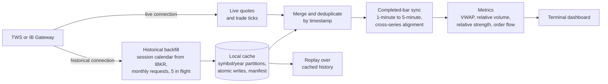

# Real-Time ETF Market Monitor

A C++20 terminal application that streams US ETF market data from the official Interactive Brokers TWS API, keeps a durable local history, and turns it into real-time market context for 33 index, sector and industry ETFs: VWAP and time-of-day relative volume on completed one-minute bars and relative strength on five-minute bars, plus Level-1 order-flow imbalance from tick data for two of them.

It is decision support only and never submits orders. It reads account positions and P&L read-only to show open-position context.

**Status:** working personal project, built in August 2026.
**Source:** private. This repository describes the data pipeline and the engineering decisions. I'm happy to walk through the code in an interview.

## At a glance

| | |
| --- | --- |
| Language | C++20 with CMake, compiled with `-Wall -Wextra -Wpedantic` |
| Size | about 17k lines excluding tests |
| Data source | Official IBKR TWS API, with separate client connections for historical backfill and live streaming |
| Storage | Local CSV cache partitioned by symbol and year, atomic writes, resumable completion manifest |
| Tests | 17 CTest executables containing 59 test functions |
| Interface | Five-page terminal dashboard that adapts to the terminal size and redraws about once a second |

## Data pipeline

## Data correctness

- **Only completed bars drive the metrics.** The bar that is still forming is excluded, and comparisons across instruments use the newest timestamp that every series has completed. Nothing compares a finished bar with a half-built one.
- **Deduplicated merges.** Live and cached bars are normalised by timestamp, sorted and deduplicated, so reconnects and repeated refreshes never double count.
- **The session calendar comes from the broker.** For the durable backfill, which days are sessions comes from IBKR's own trading schedule instead of being guessed from weekdays; session hours are fixed New York times. A scheduled session that returns nothing stays incomplete; only an explicit IBKR no-data error for a single session is recorded as known-empty.
- **New York time throughout.** Regular and extended hours are anchored separately, with explicit time-zone conversion for display.
- **The feed type is visible.** The dashboard shows whether IBKR is sending real-time or delayed data, as reported by the API, so delayed data is never mistaken for live.

## Backfill and failure handling

- **Multi-year backfill that resumes where it stopped.** Missing sessions are grouped into calendar-month requests with five in flight. Each finished month is saved immediately and recorded in a completion manifest, so an interrupted run continues from the last finished month instead of starting over.
- **Errors are classified, not retried blindly.** Pacing responses are retried. A dropped connection retries the same batch, so a backfill never ends half-populated. IBKR's market-data line-capacity error is surfaced instead, because reconnecting can't create more lines. Explicit no-data responses are recorded separately for review, and no synthetic bars are ever written.
- **Atomic file writes.** Cache partitions, manifests and schedules are written to a temporary file and renamed into place, so an interrupted process can't leave a half-written file.
- **Verified migration.** An older flat cache layout was migrated to year partitions. Every timestamp is verified in its new partition before the original files are moved to a backup folder.
- **Graceful shutdown.** In the live monitor, SIGINT and SIGTERM are handled through an async-signal-safe flag that the main loop checks.

## Testing and replay

- Tests cover bar alignment, timeframe conversion, request planning, error classification, cache storage and migration, indicators, order-flow aggregation and terminal input decoding.
- An intraday backtester replays cached one-minute history through the same decision rules, with a flat per-side cost assumption.

## Research in progress

A Python machine-learning research branch, not merged, is experimental.

## Contact

[LinkedIn](https://www.linkedin.com/in/zewen-l-531569327/) · [GitHub](https://github.com/z9wen)
